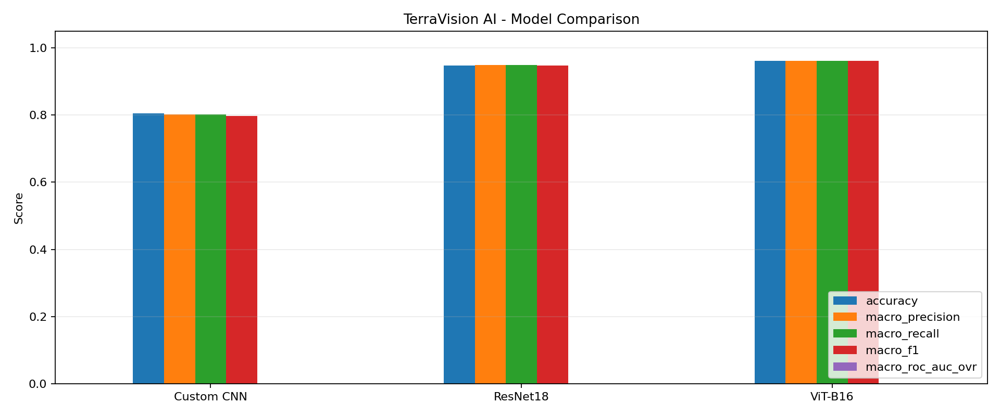
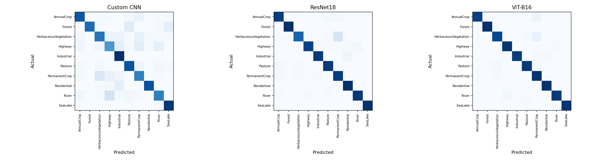

# TerraVision AI

**Satellite image land-cover classification with a custom CNN, ResNet18, and Vision Transformer.** TerraVision pairs a React + Vite dashboard with a FastAPI inference API and uses the EuroSAT RGB class set.

The dashboard supports image upload, model selection, top-three predictions, live API/device status, saved evaluation metrics, confusion matrices, and training history.

## Evaluation results

These are the values saved in [`outputs/model_comparison.json`](outputs/model_comparison.json). The dashboard reads those artifacts; it does not invent missing scores.

| Model | Accuracy | Macro precision | Macro recall | Macro F1 |
| --- | ---: | ---: | ---: | ---: |
| Custom CNN | 80.47% | 80.24% | 80.27% | 79.80% |
| ResNet18 | 94.79% | 94.92% | 94.86% | 94.70% |
| ViT-B/16 | 96.15% | 96.15% | 96.19% | 96.10% |





## Models and classes

| Model ID | Model | Input size |
| --- | --- | ---: |
| `cnn` | Custom TerraCNN | 64 × 64 |
| `resnet18` | ResNet18 | 224 × 224 |
| `vit_b16` | ViT-B/16 | 224 × 224 |

The ten EuroSAT RGB classes are AnnualCrop, Forest, HerbaceousVegetation, Highway, Industrial, Pasture, PermanentCrop, Residential, River, and SeaLake. Class names and normalization values are defined in [`metadata.json`](metadata.json).

## Repository layout

```text
backend/app.py                         FastAPI API and model inference
frontend/                              React + Vite application
frontend/public/evaluation/            Evaluation files served by the frontend
models/                                Trained PyTorch checkpoints
outputs/                               Saved scores, plots, and training history
metadata.json                          Class names and preprocessing metadata
requirements.txt                       Python API dependencies
```

The dashboard’s copies in `frontend/public/evaluation/` are static assets for the frontend build. If the files in `outputs/` change, copy the updated comparison JSON, plots, and training history into that folder as well.

## Run locally on Windows

You need Python, Node.js, and compatible PyTorch/TorchVision builds. Install the matching PyTorch and TorchVision pair for your operating system and CPU/GPU using the [official PyTorch installer](https://pytorch.org/get-started/locally/) before installing `requirements.txt`.

Open **two PowerShell windows** in the repository folder.

### 1. Start the API

In the first window, from the repository root:

```powershell
python -m venv .venv
.\.venv\Scripts\Activate.ps1
python -m pip install --upgrade pip
# Install the matching torch/torchvision command from pytorch.org/get-started/locally first.
python -m pip install -r requirements.txt
python -m uvicorn backend.app:app --host 127.0.0.1 --port 8000
```

Keep this window open. Check `http://127.0.0.1:8000/health`; it should report `healthy` and list the loaded models. The API loads the checkpoint files from `models/` when it starts.

### 2. Start the frontend

In the second window, start from the repository root:

```powershell
cd frontend
npm ci
npm run dev
```

Open the `Local` URL printed by Vite, normally **http://localhost:5173**. Leave both terminal windows running while using the app. Start only one API process on port 8000 at a time. After the first dependency install, use `npm run dev` for normal starts; run `npm ci` again only when reinstalling dependencies, and stop Vite with Ctrl+C first.

Vite proxies `/api` to the local FastAPI server in development and preview mode. To use a different API host, copy `frontend/.env.example` to `frontend/.env.local`, set `VITE_API_BASE_URL`, then restart Vite.

### Production build preview

With the API running, use a second frontend terminal:

```powershell
cd frontend
npm run build
npm run preview
```

Open the preview URL printed by Vite, normally **http://localhost:4173**.

## API

| Method | Route | Purpose |
| --- | --- | --- |
| `GET` | `/health` | API status, device, and loaded model IDs |
| `GET` | `/metrics` | Saved model comparison values |
| `POST` | `/predict` | Classify an uploaded image |

`POST /predict` accepts multipart form fields `file` and `model_name`. Valid model IDs are `cnn`, `resnet18`, and `vit_b16`. The response includes the predicted class, confidence, top-three predictions, model display name, and image dimensions.

## Evaluation files

- [`outputs/model_comparison.json`](outputs/model_comparison.json) and [`outputs/model_comparison.csv`](outputs/model_comparison.csv): recorded comparison metrics.
- [`outputs/confusion_matrices.png`](outputs/confusion_matrices.png): saved confusion matrices.
- [`outputs/model_comparison.png`](outputs/model_comparison.png): saved comparison figure.
- [`outputs/training_history.csv`](outputs/training_history.csv): training and validation history.

ROC-AUC is unavailable in the saved comparison. The saved latency values are shown as recorded, but the artifacts do not identify the hardware or measurement conditions. The checkpoints correspond to training configured for two epochs per model. Treat the scores as project evaluation results, not a guarantee of performance on new imagery. Confidence scores are model probabilities and can be wrong.

## GitHub and model files

`models/vit_b16_best.pth` is about 343 MB, above GitHub’s 100 MiB regular Git file limit. The `.gitattributes` file tracks model checkpoints with [Git LFS](https://docs.github.com/en/repositories/working-with-files/managing-large-files/about-git-large-file-storage). Install Git LFS and track the files **before the first `git add`**. GitHub LFS has storage and bandwidth quotas; check your account’s current allowance before sharing a model-heavy repository widely.

Do not commit `.env.local`, credentials, `node_modules/`, or frontend build output. These are covered by `.gitignore`.

## Limitations

- The models were trained for two epochs each; additional training and broader validation may improve generalization.
- EuroSAT is a specific dataset. Images from other sensors, resolutions, regions, or conditions can produce unreliable predictions.
- ViT-B/16 may be slow on CPU. Use a compatible GPU environment for faster inference.
- Grad-CAM is not currently exposed in the React + FastAPI workflow.
